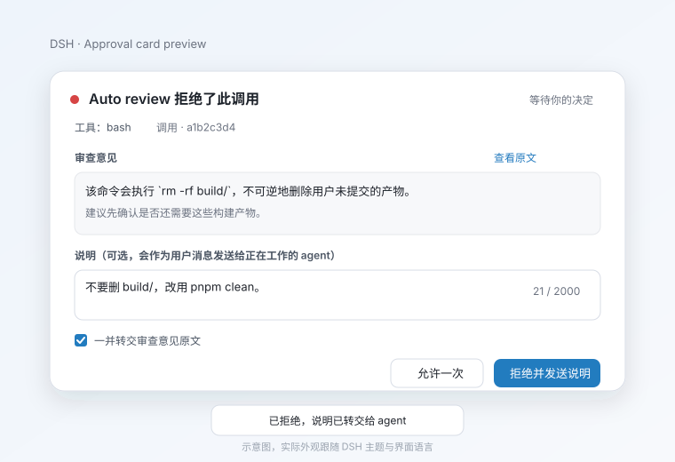

# dsh-review-relay

English | [简体中文](README.md)

## Install

Requires DSH `0.2.1-rc.2` (or a compatible `0.2.x`), with Auto review and the Web UI enabled.

In DeepSeek Harness, open the Plugins page, click "Add plugin", and enter:

```text
github:chofuhoyu/dsh-review-relay
```

You can also install it into the `web` profile from the CLI (the `github:` shorthand resolves over SSH; without a GitHub SSH key use `git+https://github.com/chofuhoyu/dsh-review-relay.git`):

```sh
dsh plugin --profile web add github:chofuhoyu/dsh-review-relay
```

Refresh the Web page after installing. The plugin:

1. listens to Auto review approval requests and returns the outcome unchanged, never altering allow/deny;
2. replaces the official approval card in the same seat with a Chinese translation, a note, and the "forward the reviewer reason verbatim" checkbox;
3. after a rejection, appends the note and reviewer reason to the rejected tool call's `tool/result`, so the model reads them in the tool result.

The `@deepseek-ai/dsh-experimental-auto-review` bundle must be installed and enabled; otherwise there is no Auto review denial to take over, and while the plugin still loads, ordinary approvals are untouched.

For local development, replace `github:chofuhoyu/dsh-review-relay` with the absolute path to your checkout.

Relay DeepSeek Harness **Auto review** rejection reasons — and the note you write when rejecting — back into the working agent. The card shows a Chinese translation, the forwarded reason stays verbatim.

> Status: `0.2.1`, installed straight from GitHub; the `lib/` build output is committed so installs need no build step. Target: DSH `0.2.x`; development baseline `0.2.1-rc.2`.



## What it fixes

When Auto review denies a tool call under the `ask` policy, the official card shows the reviewer's English reason to the user, but:

1. the reason never enters the working agent's context;
2. after “Reject” the agent only sees `the user rejected tool "..."`, not why;
3. a follow-up note (“don't delete build/; use pnpm clean”) arrives too late to match the original context;
4. the reviewer reason is English.

This plugin only **displays, annotates, and relays**. It does not decide allow/deny, does not answer the approval waterfall, and does not change tool arguments. On the default path it appends a relay block to the rejected call's own tool result instead of creating a synthetic user message.

### Why the relay lives in the tool result

An approval outcome has no “note” field: `ApprovalOutcome` is only `allowed-once | rejected | cancelled | unavailable`. The Host-side plugin therefore cannot pass the note through the approval result. The previous implementation worked around that by calling `agent.inject()`, which records a real `user/message`; the Web UI renders it as an ordinary user turn and the model treats it as user-priority input.

The current default instead enriches the denied call through `tools/post-execute`. A denied approval is still a tool result in the pipeline, so the plugin can append one text block to that result before it is committed. The model then sees the note and reviewer reason as part of the bash/tool result — the same place an `ask_user_question` answer appears — while the conversation shows no extra user bubble. `delivery: 'inject' | 'followup'` keeps the old behavior explicitly.

## Use

When Auto review denies and asks, the plugin replaces the official card in the same composer seat:

- Chinese translation by default; the English original can be expanded;
- optional note (default limit 2000 chars, with a counter);
- “Forward the reviewer reason verbatim” checked by default;
- “Allow once” and “Reject and send note”;
- rejecting with no note and no forwarding is a plain rejection and relays nothing;
- allowing never submits a note and never relays.

After a rejection, the denied tool result gains one extra text block before it is committed:

```text
User note:
<note>

Reviewer reason (verbatim):
<reviewer reason>

Reviewer reason (translated to <targetLanguage>):
<translation>
```

The tool result's own `Error: the user rejected tool "<toolName>"` line already states the decision, so it is not repeated. Empty blocks are omitted. The reviewer original is verbatim, except an explicit truncation marker when it exceeds `maxForwardChars`. The relay is part of the tool result, so it is visible when the tool row is expanded and is not displayed as a separate user message.

With `delivery: 'inject'` or `delivery: 'followup'`, the legacy template is a standalone user message instead:

```text
User rejected tool "<toolName>".

User note:
<note>

Reviewer reason (verbatim):
<reviewer reason>

Reviewer reason (translated to <targetLanguage>):
<translation>
```

## Configuration

Every knob is in the plugin `Config`; unknown fields fail at load instead of being ignored. Override the profile row:

```yaml
- id: review-relay
  config:
    enabled: true
    forwardMode: ask
    defaultForward: true
    targetLanguage: ui
    translate: true
    translateForForward: true
    translationProvider: llm
    noteEnabled: true
    noteMaxChars: 2000
    maxForwardChars: 8000
    delivery: tool-result
```

| Field | Type | Default | Meaning |
|---|---|---|---|
| `enabled` | boolean | `true` | Master switch; off registers no listener or route. |
| `reviewerReasonPattern` | string | see below | Recognition regex with `tool` / `reason` named groups; compiled once at load, invalid fails loud. |
| `noteEnabled` | boolean | `true` | Show the note input. |
| `noteForNonReviewApprovals` | boolean | `false` | Opt-in notes for ordinary approvals (no reviewer parsing). |
| `noteMaxChars` | number | `2000` | Note limit, 1–100000. |
| `forwardMode` | `'ask' \| 'always' \| 'never'` | `'ask'` | `ask` shows the checkbox; `always` forces forwarding; `never` hides it, notes still send. |
| `defaultForward` | boolean | `true` | Initial checkbox state in `ask` mode. |
| `maxForwardChars` | number | `8000` | Verbatim reason limit; overflow gets an explicit `[reviewer reason truncated at N chars]` marker. |
| `targetLanguage` | string | `'ui'` | `ui` follows the UI language, or an explicit BCP-47 tag such as `zh-CN`. |
| `translate` | boolean | `true` | Enable translation for display and forwarding. |
| `translateForForward` | boolean | `true` | Include the translation block in the relayed message. |
| `showOriginal` | boolean | `true` | Offer “Show original”. |
| `translationProvider` | `'llm' \| 'translator' \| 'off'` | `'llm'` | `llm` makes one independent request on the current session route; `translator` prefers host `ctx.translator` and falls back to `llm`; `off` disables. |
| `translationModel` | string (optional) | current session model | Override the translation model. |
| `translationTimeoutMs` | number | `10000` | Translation deadline, 100–120000. |
| `delivery` | `'tool-result' \| 'auto' \| 'inject' \| 'followup'` | `'tool-result'` | `tool-result` appends to the rejected tool result (no synthetic message). `auto` is a deprecated alias. `inject` / `followup` are legacy synthetic-user-message modes. |
| `forwardOnDirectDeny` | boolean | `false` | Also relay the reviewer reason for a direct denial with no ask (e.g. high risk / `never` policy). This path has no card and forwards the original only. |

Default recognition pattern for the shipped ask text:

```text
^Auto review denied tool "(?<tool>[^"]+)"(?:: (?<reason>[\s\S]+))?$
```

> `Auto review rejected tool "<tool>"; its body was not executed` is a **direct denial**, not an ask; it is deliberately not recognized. If Auto review changes its wording, update `reviewerReasonPattern`.

## Privacy and data

- **Translation sends data out.** The default `llm` provider sends only the **reviewer reason** (no session content, no tool arguments, no note) to the current session's model provider. Set `translate: false` or `translationProvider: off` to disable.
- `translationProvider: translator` uses the optional official `ctx.translator`; it may use anonymous Bing / Google endpoints and must be selected explicitly. Missing service falls back to `llm`.
- Notes live only in Host process memory until the approval settles. Once relayed on the default path, the note is part of the durable `tool/result` content; the legacy path stores it in a `user/message`.
- Dedup sets and translation cache are also in memory only.
- The plugin writes **no custom Session events** and never calls `appendPluginRecord`. Model-visible content comes from existing events:
  - `approval/asked.reason`;
  - `approval/decided.outcome`;
  - the existing `tool/result` content, enriched through `tools/post-execute` (default path);
  - the existing `agent/inbox/spliced` / `user/message` produced by `inject()` (legacy modes).
- Host logs never print the reviewer reason or note body.

## Safety

- The plugin only **observes** `approval/request`: it `await next()` and returns that outcome unchanged; it never returns its own outcome.
- UI unavailable, config route unavailable, invalid pattern, missing `callId`, or a crashed panel all fall back to the official card or full delegation. The plugin never turns a rejection into an allow.
- Allow once: no note submitted, no relay.
- Reject with empty note and no forwarding: no relay.
- Cancel / timeout / session close: no relay.
- Relay failure leaves the rejection intact, logs a Host warning, and surfaces an error toast through the 6-second delivery-status watch.
- Cross-session: only the tool result owned by the session/agent from the approval request is enriched.
- Dedup: `(sessionId, callId)`, or `(sessionId, toolName, reason hash)` when `callId` is absent.

## Degradation

| Scenario | Behavior |
|---|---|
| Ordinary approval | Official card. |
| Auto review absent / wording changed | No takeover, no relay. |
| No client / config route fails | Official card; no note. `forwardMode: always` still forwards the reviewer reason. |
| Note POST fails | Card stays open with an error; retry or “Reject without a note”. |
| Translation timeout / failure | Original + notice; rejection works; no empty translation block. |
| Post-execute unavailable / call never settles | No enrichment; Host warning, and an error toast within 6 seconds when `callId` is known. |
| Cancellation / session close | No relay; state cleared. |
| Duplicate submit / replay | Exactly once by approval id / callId. |
| Oversized note / reason | Note rejected; reason truncated with an explicit marker. |
| Panel crash | Dispose our chain entry; the chain re-elects the official priority-1 card. |

## Known limitations

- **The reviewer prompt is not changed.** Making Auto review itself speak Chinese needs an upstream config; this plugin only translates display and relay.
- **`conversation.approval.detail` cannot be reused.** The official `ui-approval` entry already declares that child slot; declaring it again throws. The card uses the `useChat` standard prop to render the correlated command itself. In `0.2.1-rc.2` the official detail only renders a command (no diff).
- **The relay is inside the tool result.** It appears when the denied tool row is expanded; it is not a first-class conversation bubble. That is intentional: the note is lower-priority context than a user turn, and it disappears from the main transcript.
- **Relay failure feedback has a 6-second window.** After the card closes the client briefly polls `api/review-relay/delivery`; a later failure is Host-log only. The approval result is unaffected.
- **Translation must be ready to be relayed.** Translation starts when the card appears; if the user rejects before it finishes, the result carries the verbatim reason only. Rejection is never blocked and half a translation is never attached.
- **Approvals without `callId` keep the official card.** Notes and translation are call-id addressed. Host-only `forwardMode: always` still relays the reason, matched to the next rejected result for the same session/tool.
- **Legacy modes are opt-in.** `delivery: 'inject'` / `'followup'` still create a synthetic user message and therefore still show the old main-conversation bubble.
- **Prepend is best-effort.** A future plugin that prepends and short-circuits the approval chain could hide the request. In the target composition ui-approval / ACP are ordinary listeners.

See [doc/manual-e2e.md](doc/manual-e2e.md) for the AC-1 … AC-14 click-through checklist.

## Development

```sh
npm install
npm run check   # typecheck + unit/integration tests + build + client bundle verification
```

- `npm run build`: Host via `tsc` into `lib/`; Client via esbuild into the DSH module-loader closure factory `lib/client.js`.
- `npm run test`: unit + integration.
- `npm run verify:client`: executes `lib/client.js` in Node the way the DSH module loader does, checking the wrapper, factory, inject list, and priority-0 selector.
- `tests/m0/`: M0 reconnaissance probes (real auto-review reason, prepend/await next, step boundary, client pitfalls).

Real composition check (run locally):

```sh
# 1. install the local package into a throwaway profile
dsh plugin --profile relay-test add /path/to/dsh-review-relay
# 2. the composed tree contains the review-relay row
dsh --profile relay-test --dump-config | grep -A2 review-relay
# 3. boot Web; the index boot graph contains dsh-review-relay/client.js
# 4. GET /api/review-relay/config returns protocol: 1
```

## Layout

```
src/index.ts          Host entry (name/inject/Config/apply)
src/host/             Host: config, recognition, template, translation, dedup, routes, delivery
src/client/           Client: priority-0 card, note, translation, toast, crash fallback
src/shared/           Pure shared values and functions
cordis.patch.yml      Bundle layer: insert id=review-relay
locale/               Plugin-market meta copy (zh/en)
tests/                unit / integration / m0
```

## License

MIT. See [LICENSE](LICENSE).
