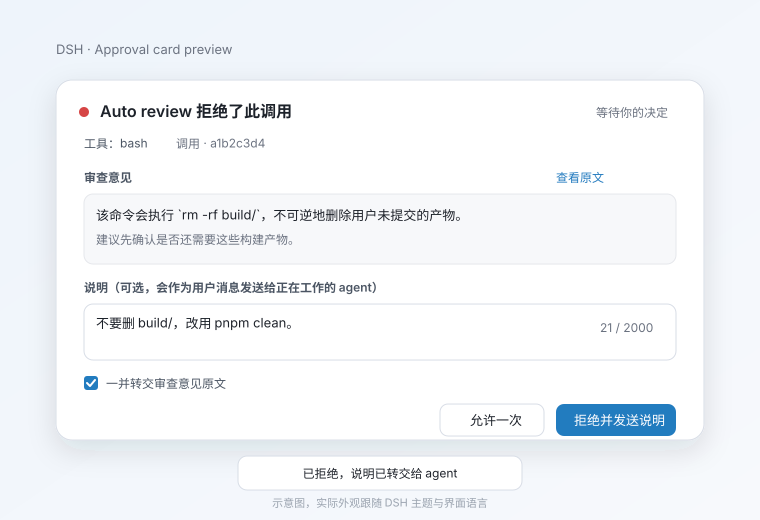

# dsh-review-relay

Relay DeepSeek Harness **Auto review** rejection reasons — and the note you write when rejecting — back into the working agent. The card shows a Chinese translation, the forwarded reason stays verbatim.

> Status: `0.1.0`, distributed from GitHub only, **not published to npm**. Target: DSH `0.2.x`; development baseline `0.2.1-rc.2`.



## What it fixes

When Auto review denies a tool call under the `ask` policy, the official card shows the reviewer's English reason to the user, but:

1. the reason never enters the working agent's context;
2. after “Reject” the agent only sees `the user rejected tool "..."`, not why;
3. a follow-up note (“don't delete build/; use pnpm clean”) arrives too late to match the original context;
4. the reviewer reason is English.

This plugin only **displays, annotates, and relays**. It does not decide allow/deny, does not answer the approval waterfall, and does not rewrite tool arguments or results.

## Install

Requires DSH `0.2.1-rc.2` (or a compatible `0.2.x`), Auto review enabled, and the Web UI.

From GitHub (not published to npm):

```sh
dsh plugin --profile web add git+https://github.com/chofuhoyu/dsh-review-relay.git
```

Or from a local checkout:

```sh
git clone git@github.com:chofuhoyu/dsh-review-relay.git
dsh plugin --profile web add ./dsh-review-relay
```

Restart / reload the Web UI. Confirm the bundle row:

```sh
dsh --profile web --dump-config | grep -A2 review-relay
```

Without Auto review the plugin still loads, but takes over no approval; ordinary approvals are untouched.

## Use

When Auto review denies and asks, the plugin replaces the official card in the same composer seat:

- Chinese translation by default; the English original can be expanded;
- optional note (default limit 2000 chars, with a counter);
- “Forward the reviewer reason verbatim” checked by default;
- “Allow once” and “Reject and send note”;
- rejecting with no note and no forwarding is a plain rejection and injects nothing;
- allowing never submits a note and never injects.

After a rejection, the working agent receives one user message before its next model request:

```text
User rejected tool "<toolName>".

User note:
<note>

Reviewer reason (verbatim):
<reviewer reason>

Reviewer reason (translated to <targetLanguage>):
<translation>
```

Empty blocks are omitted. The reviewer original is verbatim, except an explicit truncation marker when it exceeds `maxForwardChars`.

## Configuration

Every knob is in the plugin `Config`; unknown fields fail at load instead of being ignored. Override the profile row:

```yaml
- id: review-relay
  config:
    enabled: true
    forwardMode: ask
    defaultForward: true
    targetLanguage: ui
    translate: true
    translateForForward: true
    translationProvider: llm
    noteEnabled: true
    noteMaxChars: 2000
    maxForwardChars: 8000
    delivery: auto
```

| Field | Type | Default | Meaning |
|---|---|---|---|
| `enabled` | boolean | `true` | Master switch; off registers no listener or route. |
| `reviewerReasonPattern` | string | see below | Recognition regex with `tool` / `reason` named groups; compiled once at load, invalid fails loud. |
| `noteEnabled` | boolean | `true` | Show the note input. |
| `noteForNonReviewApprovals` | boolean | `false` | Opt-in notes for ordinary approvals (no reviewer parsing). |
| `noteMaxChars` | number | `2000` | Note limit, 1–100000. |
| `forwardMode` | `'ask' \| 'always' \| 'never'` | `'ask'` | `ask` shows the checkbox; `always` forces forwarding; `never` hides it, notes still send. |
| `defaultForward` | boolean | `true` | Initial checkbox state in `ask` mode. |
| `maxForwardChars` | number | `8000` | Verbatim reason limit; overflow gets an explicit `[reviewer reason truncated at N chars]` marker. |
| `targetLanguage` | string | `'ui'` | `ui` follows the UI language, or an explicit BCP-47 tag such as `zh-CN`. |
| `translate` | boolean | `true` | Enable translation for display and forwarding. |
| `translateForForward` | boolean | `true` | Include the translation block in the relayed message. |
| `showOriginal` | boolean | `true` | Offer “Show original”. |
| `translationProvider` | `'llm' \| 'translator' \| 'off'` | `'llm'` | `llm` makes one independent request on the current session route; `translator` prefers host `ctx.translator` and falls back to `llm`; `off` disables. |
| `translationModel` | string (optional) | current session model | Override the translation model. |
| `translationTimeoutMs` | number | `10000` | Translation deadline, 100–120000. |
| `delivery` | `'auto' \| 'inject' \| 'followup'` | `'auto'` | `auto` injects while a turn is open, otherwise follows up. |
| `forwardOnDirectDeny` | boolean | `false` | Also relay the reviewer reason for a direct denial with no ask (e.g. high risk / `never` policy) as one extra user message. |

Default recognition pattern for the shipped ask text:

```text
^Auto review denied tool "(?<tool>[^"]+)"(?:: (?<reason>[\s\S]+))?$
```

> `Auto review rejected tool "<tool>"; its body was not executed` is a **direct denial**, not an ask; it is deliberately not recognized. If Auto review changes its wording, update `reviewerReasonPattern`.

## Privacy and data

- **Translation sends data out.** The default `llm` provider sends only the **reviewer reason** (no session content, no tool arguments, no note) to the current session's model provider. Set `translate: false` or `translationProvider: off` to disable.
- `translationProvider: translator` uses the optional official `ctx.translator`; it may use anonymous Bing / Google endpoints and must be selected explicitly. Missing service falls back to `llm`.
- Notes live only in Host process memory and are cleared when the approval settles; they are not persisted to the Session.
- Dedup sets and translation cache are also in memory only.
- The plugin writes **no custom Session events** and never calls `appendPluginRecord`. Model-visible content comes from existing events:
  - `approval/asked.reason`;
  - `approval/decided.outcome`;
  - the existing `agent/inbox/spliced` / `user/message` produced by `inject()`.
- Host logs never print the reviewer reason or note body.

## Safety

- The plugin only **observes** `approval/request`: it `await next()` and returns that outcome unchanged; it never returns its own outcome.
- UI unavailable, config route unavailable, invalid pattern, missing `callId`, or a crashed panel all fall back to the official card or full delegation. The plugin never turns a rejection into an allow.
- Allow once: no note submitted, no injection.
- Reject with empty note and no forwarding: no injection.
- Cancel / timeout / session close: no injection.
- Injection failure leaves the rejection intact, retries at most once, logs a Host warning, and surfaces an error toast through the 6-second delivery-status watch.
- Cross-session: only the agent/session from the approval request is injected.
- Dedup: `(sessionId, callId)`, or `(sessionId, toolName, reason hash)` when `callId` is absent.

## Degradation

| Scenario | Behavior |
|---|---|
| Ordinary approval | Official card. |
| Auto review absent / wording changed | No takeover, no injection. |
| No client / config route fails | Official card; no note. `forwardMode: always` still forwards the reviewer reason. |
| Note POST fails | Card stays open with an error; retry or “Reject without a note”. |
| Translation timeout / failure | Original + notice; rejection works; no empty translation block. |
| Injection failure | Approval stays rejected; Host warning plus an error toast within 6 seconds; one retry. |
| Cancellation / session close | No injection; state cleared. |
| Duplicate submit / replay | Exactly once by approval id / callId. |
| Oversized note / reason | Note rejected; reason truncated with an explicit marker. |
| Panel crash | Dispose our chain entry; the chain re-elects the official priority-1 card. |

## Known limitations

- **The reviewer prompt is not changed.** Making Auto review itself speak Chinese needs an upstream config; this plugin only translates display and relay.
- **`conversation.approval.detail` cannot be reused.** The official `ui-approval` entry already declares that child slot; declaring it again throws. The card uses the `useChat` standard prop to render the correlated command itself. In `0.2.1-rc.2` the official detail only renders a command (no diff).
- **Injection failure feedback has a 6-second window.** After the card closes the client briefly polls `api/review-relay/delivery`; a later failure is Host-log only. The approval result is unaffected.
- **Translation must be ready to be forwarded.** Translation starts when the card appears; if the user rejects before it finishes, the message carries the verbatim reason only. Rejection is never blocked and half a translation is never injected.
- **Approvals without `callId` keep the official card.** Notes and translation are call-id addressed. Host-only `forwardMode: always` still relays the reason.
- **Prepend is best-effort.** A future plugin that prepends and short-circuits the approval chain could hide the request. In the target composition ui-approval / ACP are ordinary listeners.

See [doc/manual-e2e.md](doc/manual-e2e.md) for the AC-1 … AC-14 click-through checklist.

## Development

```sh
npm install
npm run check   # typecheck + unit/integration tests + build + client bundle verification
```

- `npm run build`: Host via `tsc` into `lib/`; Client via esbuild into the DSH module-loader closure factory `lib/client.js`.
- `npm run test`: unit + integration.
- `npm run verify:client`: executes `lib/client.js` in Node the way the DSH module loader does, checking the wrapper, factory, inject list, and priority-0 selector.
- `tests/m0/`: M0 reconnaissance probes (real auto-review reason, prepend/await next, step boundary, client pitfalls).

Real composition check (run locally):

```sh
# 1. install the local package into a throwaway profile
dsh plugin --profile relay-test add /path/to/dsh-review-relay
# 2. the composed tree contains the review-relay row
dsh --profile relay-test --dump-config | grep -A2 review-relay
# 3. boot Web; the index boot graph contains dsh-review-relay/client.js
# 4. GET /api/review-relay/config returns protocol: 1
```

## Layout

```
src/index.ts          Host entry (name/inject/Config/apply)
src/host/             Host: config, recognition, template, translation, dedup, routes, delivery
src/client/           Client: priority-0 card, note, translation, toast, crash fallback
src/shared/           Pure shared values and functions
cordis.patch.yml      Bundle layer: insert id=review-relay
locale/               Plugin-market meta copy (zh/en)
tests/                unit / integration / m0
```

## License

MIT. See [LICENSE](LICENSE).
