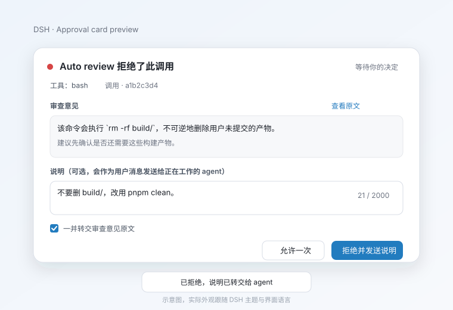

# dsh-review-relay

把 DeepSeek Harness **Auto review** 的拒绝意见，连同你在拒绝时写下的说明，可靠地送进正在工作的 agent 上下文；审查意见以中文展示，原文逐字保留。

> 状态：`0.1.0`，目前只通过 GitHub 分发，**未发布到 npm**。目标运行时 DSH `0.2.x`，开发基线 `0.2.1-rc.2`。



## 它解决什么

Auto review 判 deny、审批策略为 `ask` 时，官方卡片会把 reviewer 的英文意见展示给用户，但：

1. 意见不会进入工作 agent 的上下文；
2. 用户点“拒绝”后 agent 只知道 `the user rejected tool "..."`，不知道原因；
3. 用户想补一句“不要删 build/，改用 pnpm clean”，只能等拒绝后再单独发消息，和当时的上下文对不上；
4. reviewer 意见是英文，中文用户读起来费劲。

本插件只做三件事：**展示、附言、转交**。它不参与 allow/deny 判定，不接管审批语义，也不修改工具参数或结果。

## 安装

要求：DSH `0.2.1-rc.2` 或兼容的 `0.2.x`，已启用 Auto review，使用 Web UI。

从 GitHub 安装到 profile（当前未发布 npm）：

```sh
dsh plugin --profile web add git+https://github.com/chofuhoyu/dsh-review-relay.git
```

或从本地 checkout 安装：

```sh
git clone git@github.com:chofuhoyu/dsh-review-relay.git
dsh plugin --profile web add ./dsh-review-relay
```

安装后重启 / 刷新 Web UI。确认 profile 里有 `review-relay` 行：

```sh
dsh --profile web --dump-config | grep -A2 review-relay
```

没有 auto-review 时插件正常加载，但不会接管任何审批；普通审批完全不受影响。

## 使用

Auto review 判 deny 并弹出审批卡片时，本插件会用一张同位置的卡片替换官方卡片：

- 审查意见默认显示中文译文，可展开英文原文；
- 可选填写说明（默认上限 2000 字，带计数器）；
- “一并转交审查意见原文”默认勾选；
- “允许一次”与“拒绝并发送说明”；
- 拒绝且说明/转交都为空时，等同于普通拒绝，不注入任何内容；
- 允许一次不会提交说明，也不会注入。

拒绝成功后，工作 agent 会在下一次模型请求前收到一条 user 消息，格式固定：

```text
User rejected tool "<toolName>".

User note:
<note>

Reviewer reason (verbatim):
<reviewer reason>

Reviewer reason (translated to <targetLanguage>):
<translation>
```

空块会被省略；reviewer 原文逐字保留（超过 `maxForwardChars` 时显式截断并标记）。

## 配置

所有字段都在插件 `Config` 中，加载期校验；未知字段会直接报错，不会静默忽略。配置示例（覆盖 profile 中的 `review-relay` 行）：

```yaml
- id: review-relay
  config:
    enabled: true
    forwardMode: ask
    defaultForward: true
    targetLanguage: ui
    translate: true
    translateForForward: true
    translationProvider: llm
    noteEnabled: true
    noteMaxChars: 2000
    maxForwardChars: 8000
    delivery: auto
```

| 字段 | 类型 | 默认 | 说明 |
|---|---|---|---|
| `enabled` | boolean | `true` | 总开关；关闭后不注册监听器和端点。 |
| `reviewerReasonPattern` | string | 见下 | 识别审查型审批的正则，必须含 `tool` / `reason` 命名组；加载时编译一次，非法即失败。 |
| `noteEnabled` | boolean | `true` | 是否显示附言输入框。 |
| `noteForNonReviewApprovals` | boolean | `false` | 普通审批是否也允许附言（不解析 reviewer 意见）。 |
| `noteMaxChars` | number | `2000` | 附言上限，1–100000。 |
| `forwardMode` | `'ask' \| 'always' \| 'never'` | `'ask'` | `ask` 显示勾选框；`always` 强制转交；`never` 不转交，附言仍可发送。 |
| `defaultForward` | boolean | `true` | `ask` 模式下勾选框默认值。 |
| `maxForwardChars` | number | `8000` | 转交原文上限，超出截断并追加 `[reviewer reason truncated at N chars]`。 |
| `targetLanguage` | string | `'ui'` | `ui` 跟随界面语言；也可显式 BCP-47，如 `zh-CN`。 |
| `translate` | boolean | `true` | 是否启用翻译（展示与转交共用）。 |
| `translateForForward` | boolean | `true` | 转交消息里是否附带译文块。 |
| `showOriginal` | boolean | `true` | 卡片是否提供“查看原文”。 |
| `translationProvider` | `'llm' \| 'translator' \| 'off'` | `'llm'` | `llm` 用当前会话 provider/model 做一次独立请求；`translator` 优先用宿主 `ctx.translator`，没有则降级 `llm`；`off` 关闭。 |
| `translationModel` | string（可选） | 当前会话模型 | 指定翻译模型。 |
| `translationTimeoutMs` | number | `10000` | 翻译超时，100–120000。 |
| `delivery` | `'auto' \| 'inject' \| 'followup'` | `'auto'` | `auto` 有打开回合用 `inject`，空闲用 `followup`。 |
| `forwardOnDirectDeny` | boolean | `false` | 直接拒绝（无 ask，如 high 风险 / `never` 策略）也把 reviewer 理由作为一条额外 user 消息转交。 |

默认识别规则（匹配 `0.2.1-rc.2` 的真实 ask 文案）：

```text
^Auto review denied tool "(?<tool>[^"]+)"(?:: (?<reason>[\s\S]+))?$
```

> 注意：`Auto review rejected tool "<tool>"; its body was not executed` 是**直接拒绝**，不是 ask；本插件不会把它误判成审查型审批。auto-review 未来改文案时，用 `reviewerReasonPattern` 跟进即可。

## 隐私与数据

- **翻译是数据外发。** 默认 `translationProvider: llm` 会把 **reviewer reason**（不含会话内容、不含工具参数、不含附言）发送给当前会话的模型 provider。设为 `translate: false` 或 `translationProvider: off` 可完全关闭。
- `translationProvider: translator` 只在宿主安装并提供官方 `ctx.translator` 时使用；该服务可能走匿名 Bing / Google 端点，需你显式选择。探测不到时自动降级到 `llm`。
- 附言只存在 Host 进程内存，审批结算后清除；不落 Session，不持久化。
- 去重集合、翻译缓存同样只在内存，进程退出即丢。
- 插件**不写任何自定义 Session 事件**，也不调用 `appendPluginRecord`。模型可见内容来自：
  - `approval/asked.reason`（Host 已有）；
  - `approval/decided.outcome`（Host 已有）；
  - `inject()` 产生的既有 `agent/inbox/spliced` / `user/message`（Host 已有）。
- 调试日志走 Host logger，不打印 reviewer 原文或附言正文。

## 安全边界

- 插件只**观察** `approval/request`，`await next()` 后原样返回 outcome；从不返回自己的决定。
- UI 不可用、配置端点不可用、正则非法、没有 `callId`、面板崩溃：都退回官方审批卡片或完全委托，绝不自动放行。
- 允许一次：不提交附言、不注入。
- 拒绝但说明/转交为空：不注入。
- 取消 / 超时 / 会话关闭：不注入。
- 注入失败：审批仍然是拒绝，最多重试一次，并写 Host 警告日志；不会重试风暴。
- 跨会话：只注入 `approval/request` 带来的同一个 agent / session。
- 去重：`(sessionId, callId)`；`callId` 缺失时用 `(sessionId, toolName, reason 哈希)` 兜底。

## 失败与降级

| 场景 | 行为 |
|---|---|
| 非审查审批 | 完全委托官方卡片。 |
| auto-review 未安装 / 文案不匹配 | 不接管、不注入。 |
| Client 未连接 / config 端点失败 | 官方卡片；没有附言可转交；`forwardMode: always` 时仍只转交审查意见。 |
| 附言 POST 失败 | 卡片保持打开，显示错误；可重试或“不带说明直接拒绝”。 |
| 翻译超时 / 失败 | 显示原文 + 提示；拒绝照常；不注入空译文块。 |
| 注入失败 | 审批仍是拒绝；Host 日志可见；最多一次重试。 |
| 审批取消 / 会话关闭 | 不注入，清理状态。 |
| 重复提交 / 重放 | 按审批 id / callId 去重，恰好一次。 |
| 超长附言 / 审查意见 | 附言超限阻止提交；审查意见按配置截断并显式标记。 |
| 面板崩溃 | 主动 dispose 本插件 chain entry，链重新选举，官方 priority-1 卡片接上。 |

## 已知限制

- **不承诺让 reviewer 输出中文。** reviewer prompt 在 auto-review 包里；本插件只翻译展示和转交。
- **`conversation.approval.detail` 子槽不能复用。** 该槽由官方 `ui-approval` entry 声明，第二个 chain entry 再声明会抛错。本插件不声明它，而是用 `useChat` 标准 prop 自己渲染关联命令；`0.2.1-rc.2` 的官方详情本来也只渲染命令，没有 diff。
- **注入失败没有 toast。** 失败写 Host 日志；卡片在拒绝后已关闭。审批结果不受影响。
- **翻译来不及就只转原文。** 翻译在卡片出现时并行开始；用户拒绝时若译文尚未就绪，转交消息只含原文块，不阻塞拒绝、不注入半截译文。
- **没有 `callId` 的审批不接管卡片**，因为附言和翻译端点都以 `callId` 寻址；Host-only 的 `forwardMode: always` 仍可转交原文。
- **prepend 是“在已有监听器之前”**；如果未来有插件再 prepend 并短路审批链，本插件可能观察不到。目标组合中 ui-approval / ACP 都是普通监听器。

## 开发与验证

```sh
npm install
npm run check   # typecheck + unit/integration tests + build + client bundle verify
```

- `npm run build`：Host 用 `tsc` 输出 `lib/`，Client 用 esbuild 输出 DSH module-loader 闭包工厂 `lib/client.js`。
- `npm run test`：单元 + 集成测试。
- `npm run verify:client`：在 Node 里按 DSH 模块加载器的方式执行 `lib/client.js`，验证 wrapper、factory、inject 列表和 priority-0 选择器。
- `tests/m0/`：M0 侦察探针（真实 auto-review reason、prepend/await next、step 边界、客户端坑位）。

真实组合验证（本机已跑过）：

```sh
# 1. 临时 profile 安装本地包
dsh plugin --profile relay-test add /path/to/dsh-review-relay
# 2. 组合树里出现 review-relay 行
dsh --profile relay-test --dump-config | grep -A2 review-relay
# 3. 启动 Web，index 的 boot graph 里有 dsh-review-relay/client.js
# 4. GET /api/review-relay/config 返回 protocol: 1
```

## 目录

```
src/index.ts          Host 插件入口（name/inject/Config/apply）
src/host/             Host：配置、识别、模板、翻译、去重、端点、投递
src/client/           Client：priority-0 卡片、附言、翻译、toast、崩溃回退
src/shared/           两端共享的纯函数与类型
cordis.patch.yml      bundle 层：插入 id=review-relay
locale/               插件市场 meta 文案（中/英）
tests/                unit / integration / m0
```

## License

MIT。见 [LICENSE](LICENSE)。
